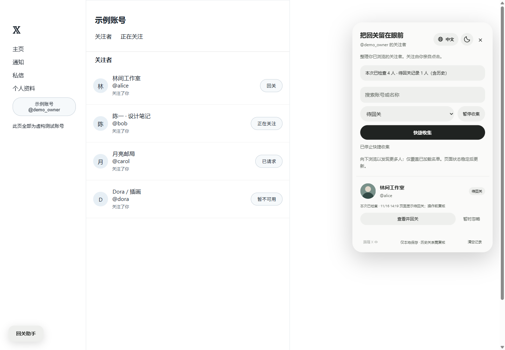

# X 回关助手

面向桌面 Chrome / Edge 的本地浏览器扩展。整理自己已经浏览的关注者，找出“关注了我、但我还没回关”的人。关注动作始终由用户亲自点击 X 原生按钮。

**下载：** [最新版本与安装包](https://github.com/wr316yn/x-followback-helper/releases/latest) · [安装教程](安装使用.md) · [隐私说明](PRIVACY.md)

在 Release 的 Assets 中下载 `x-followback-helper-v1.2.1.zip`，解压后加载里面的 `X回关助手` 文件夹。`x-followback-helper-v1.2.1-source.zip` 用于开发，不能直接当作已构建扩展安装。本地构建的 ZIP 使用中文文件名，内容相同。



- 搜索账号和名称，按待回关、已关注、请求待批准、状态未知及已忽略筛选。
- 本地保存名单、检查时间和忽略记录，按登录账号隔离。
- 跟随用户滚动收集已加载的关注者；支持手动启动快捷滚动收集，不保证抓取全量列表。
- 对列表中的账号定位原生按钮；账号已经滚动离开页面则打开主页。
- 在已收集账号的主页观察页面关注状态，跨标签页同步。
- 暂停 / 继续收集、清空当前账号记录、浅色 / 深色主题。

**安装：** 见 [安装使用.md](安装使用.md)。无需 Node.js、服务器或 API Key。

## 开发

使用 Node.js 22.12+（本机以 Node.js 26.7.0 验证）。

```sh
npm ci
npm test
npm run build
```

在 Chrome / Edge 扩展管理页开启开发者模式，加载 `dist` 文件夹。修改源码后重新构建、在扩展页点击“重新加载”，再刷新 X 页面。

### 浏览器测试

测试通过 Playwright 使用独立临时浏览器配置，将 `https://x.com/**` 请求替换为虚构页面。不会登录真实账号，不会向 X 提交关注请求。测试中的“手动点击”是测试脚本点击虚构按钮。

```powershell
# 首次使用可安装 Playwright 自带 Chromium
npx playwright install chromium
npm run test:browser

# 也可指定支持加载扩展的浏览器程序
$env:PW_EXECUTABLE_PATH = '完整路径\chrome.exe'
npm run test:browser
```

`PW_MODE=extension`（默认）测试真正的 Manifest V3 扩展、后台和 storage。某些品牌浏览器限制命令行加载扩展，可用 `PW_MODE=shim` 验证页面 UI 与 DOM 逻辑；shim 结果不能当作扩展安装验收。`PW_LABEL` 可设置输出文件前缀。截图和机器可读报告在 `artifacts`。

本机 Chrome 的最终测试通过设置 `PW_INSTALL_CDP=true` 使用开发者调试协议加载扩展完成；仍是真正的扩展测试，且仅在独立临时配置中开启调试。普通用户安装不需要此设置，按安装文档在扩展管理页加载即可。

```sh
npm run package
```

产物在 `release`，包括安装 ZIP 和源码 ZIP。

## 模块与维护

- `src/adapter.ts`：X 页面归属、关注者身份和按钮状态识别；X 改版时优先检查这里。
- `src/content.ts`：Shadow DOM 面板、页面观察、状态稳定等待、手动定位。
- `src/model.ts` 和 `src/background.ts`：本地数据合并、账号隔离、跨标签页串行写入、清空版本控制。

没有对外 API，没有远程代码。权限只有 `storage`，内容脚本匹配 `https://x.com/*`。

完整限制与实测边界见 [TEST-REPORT.md](TEST-REPORT.md)，参考案例见 [REFERENCES.md](REFERENCES.md)。

## v1.1.0：语言与快捷收集

面板右上角点击 English / 中文切换语言，选择保存在本地。账号名称保持原文。

在自己的关注者页面点击“快捷收集 / Quick collect”，每 3 秒自动浏览约三分之二屏；可随时点击停止。切换页面、账号、隐藏标签页、暂停收集或发现提示框时停止；连续约 15 秒没有新账号或浏览达到 100 步也会停止。这不代表已经收集全部关注者。插件不会自动关注。

### v1.1.1 语言按钮

右上角语言按钮改为地球图标与胶囊样式，显示当前语言 EN / 中文，点击切换到另一种语言。深色面板使用深灰底与浅色图标，浅色面板使用浅灰底。

## v1.2.0：主题切换

语言按钮旁新增太阳 / 月亮圆形按钮，点击切换日光与黑夜主题。默认根据 X 页面背景选择浅色或深色；手动选择会保存并同步到同一浏览器的其他标签页。底部“跟随 X”可恢复自动适配。只改变助手界面，不改变 X 网站主题。
